  

  Hi, I'm <b>Dumboojoo</b> 👋 I make games in <b>Roblox</b>. 
  Right now I'm working on my biggest project yet: an open world where you can climb any cliff and glide from any peak.

<!-- Das Banner (assets/banner.svg) zeichnet tools/zeichne_profil.py. Texte dort ändern und neu ausführen. -->
