  

  Hi, I'm <b>Dumboojoo</b> 👋 I make games in <b>Roblox</b>. 
  Right now I'm working on my biggest project yet: an open world where you can climb any cliff and glide from any peak.

  

  

  

<!-- Alle Bilder in assets/ zeichnet tools/zeichne_profil.py. Texte dort ändern und neu ausführen. -->
